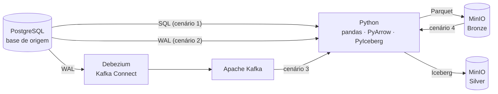

# Laboratório de Coleta e Ingestão de Dados

Ambiente didático e reproduzível para o estudo das principais estratégias de coleta (*data collect*) e ingestão de dados. O percurso vai de um banco transacional relacional até um *lakehouse* com tabelas Apache Iceberg.

## 1. Apresentação

Em sistemas de dados, um dos primeiros desafios de engenharia é extrair dados de sistemas transacionais e levá-los a um ambiente analítico de forma confiável, eficiente e auditável. Não existe uma estratégia única: a escolha depende da latência exigida, do volume, da capacidade de detectar alterações na origem e das garantias de consistência no destino.

Este laboratório reúne, num único ambiente local executado com Docker, os componentes necessários para implementar e comparar essas estratégias na prática:
- uma base relacional de origem com dados sintéticos realistas;
- um *data lake* compatível com S3;
- uma plataforma de *streaming* com captura de alterações (CDC);
- um ambiente Python padronizado para todos os participantes.

## 2. Objetivo geral

Capacitar o aluno a **projetar, implementar e avaliar pipelines de ingestão de dados**, desde a extração em lote até a captura de alterações em tempo real e a persistência transacional (ACID) em *lakehouse*. O aluno deve ser capaz de justificar tecnicamente a estratégia adequada a cada contexto.

## 3. Objetivos específicos

Ao concluir o laboratório, espera-se que o aluno seja capaz de:

1. **Diferenciar estratégias de extração** (carga completa, carga incremental por marca d'água e captura de alterações por log) e identificar as limitações de cada uma: exclusões físicas invisíveis à consulta, transações longas e tabelas sem marca temporal.
2. **Implementar extração em lote** de um banco relacional para arquivos Parquet num armazenamento de objetos, preservando tipos de dados, precisão decimal e codificação de caracteres.
3. **Compreender o funcionamento do *Write-Ahead Log*** do PostgreSQL e da replicação lógica (slots, publicações, decodificador `pgoutput`) e usá-lo como fonte de alterações em lote.
4. **Construir um pipeline de *streaming* CDC** com Debezium e Apache Kafka, interpretando os eventos de alteração (estado anterior e posterior, tipo de operação) e consumindo-os com garantias de entrega.
5. **Aplicar o modelo em camadas (*medallion*)**, promovendo dados da camada Bronze (bruta) para a Silver (tratada) em tabelas Apache Iceberg, com transações ACID, *snapshots*, *time travel* e evolução de esquema.
6. **Adotar práticas de engenharia de dados de nível profissional:**
   - idempotência no reprocessamento;
   - tratamento explícito de falhas;
   - verificação de qualidade por invariantes;
   - proteção de credenciais;
   - reprodutibilidade do ambiente.

## 4. Cenários de ingestão

| # | Cenário | Fluxo | Conceitos centrais |
|---|---|---|---|
| 1 | Batch relacional | PostgreSQL → Python/pandas → MinIO (Parquet) | Carga completa e incremental, marca d'água, formato colunar, particionamento |
| 2 | Batch CDC | PostgreSQL (WAL) → Python/pandas → MinIO | Replicação lógica, slots, LSN, captura de exclusões |
| 3 | Streaming CDC | PostgreSQL (WAL) → Debezium → Apache Kafka → Python → MinIO | Eventos de alteração, tópicos, *offsets*, semântica de entrega |
| 4 | Lakehouse ACID | MinIO (Bronze, Parquet) → PyIceberg + PyArrow → MinIO (Silver, Iceberg) | Formato de tabela aberto, *upsert*, *snapshots*, *time travel* |

**Estado atual:** a infraestrutura, a base de origem e a rotina de geração de dados estão concluídas e verificadas. Os cenários 1 a 4 serão implementados nas próximas etapas.

## 5. Arquitetura



| Componente | Tecnologia | Papel |
|---|---|---|
| Origem | PostgreSQL 17 (replicação lógica) | Sistema transacional de um comércio eletrônico fictício |
| Armazenamento | MinIO (API S3) | *Data lake*: buckets `bronze` e `silver` |
| Streaming | Apache Kafka 3.9 (KRaft) + Debezium 3.2 | Captura e transporte de alterações |
| Processamento | Python 3.12, pandas, PyArrow, PyIceberg, confluent-kafka | Scripts e notebooks dos cenários |
| Interface | JupyterLab | Ambiente de estudo e experimentação |

## 6. Princípios do laboratório

- **Reprodutibilidade:**
  - todas as imagens e bibliotecas têm versão fixada;
  - a carga de dados é determinística para uma mesma semente (`--seed`);
  - o ambiente roda inteiramente em contêineres.
- **Dados sintéticos:** a base contém apenas dados fictícios, sem informação pessoal real.
- **Realismo didático:** a base de origem inclui de propósito os desafios típicos da ingestão: tabela legada sem marca temporal, exclusões lógicas e físicas, dados semiestruturados (JSON), valores monetários de precisão exata e alterações contínuas.
- **Segurança por padrão:** credenciais apenas em variáveis de ambiente, serviços acessíveis somente pela máquina local e usuário de CDC com privilégio mínimo.
- **Simplicidade:** código procedural e comentado, com um único comando para subir o ambiente.

## 7. Público-alvo e pré-requisitos

**Público-alvo:** estudantes e profissionais de Engenharia de Dados, Ciência de Dados e Engenharia de Software interessados em integração e ingestão de dados.

**Conhecimentos recomendados:**
- SQL básico;
- Python básico (funções, estruturas de dados);
- noções de linha de comando.

**Requisitos de software:**
- Docker Desktop (ou Docker Engine) com Docker Compose v2;
- pelo menos 4 GiB de memória disponível para o Docker;
- cerca de 7 GB de disco para imagens e volumes.

Não é necessário instalar Python na máquina: todo o código é executado no contêiner do laboratório.

## 8. Início rápido

```powershell
# 1. Criar o arquivo de configuração e definir senhas próprias (substituir os valores "change_me")
Copy-Item .env.example .env          # Linux/macOS: cp .env.example .env

# 2. Construir e subir o ambiente
docker compose up -d --build --wait

# 3. Popular a base de origem com dados sintéticos
docker compose exec python python src/populate.py seed --seed 42

# 4. Abrir o JupyterLab e executar notebooks/00_teste_servicos.ipynb
#    http://127.0.0.1:<JUPYTER_PORT>/lab?token=<JUPYTER_TOKEN>   (valores definidos no .env)
```

Para encerrar mantendo os dados: `docker compose down`. Para apagar todos os dados do laboratório: `docker compose down -v`.

## 9. Documentação

| Documento | Conteúdo |
|---|---|
| [Infraestrutura](docs/01_infraestrutura.md) | Arquitetura, serviços, configuração, rede, segurança, operação e solução de problemas |
| [Base de dados de origem](docs/02_banco_de_origem.md) | Modelo de dados, dicionário, decisões de modelagem, rotina de geração de dados e invariantes de qualidade |

## 10. Estrutura do repositório

```
lab_datacollect/
├── docker-compose.yml     # Orquestração dos serviços
├── Dockerfile             # Imagem do ambiente Python
├── requirements.txt       # Dependências Python (versões fixadas)
├── .env.example           # Modelo de configuração
├── sql/                   # Inicialização do PostgreSQL (CDC e esquema)
├── src/                   # Código-fonte (geração de dados e cenários)
├── notebooks/             # Notebooks de estudo e verificação
├── docs/                  # Documentação técnica
└── data/                  # Artefatos locais (não versionados)
```
