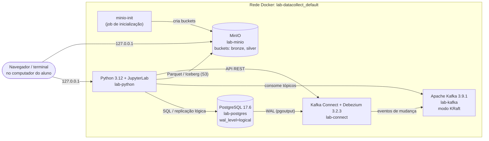

# Infraestrutura do Laboratório de Coleta de Dados

## 1. Objetivo

Este documento descreve a infraestrutura do laboratório de estudo de coleta e ingestão de dados (*data collect*). O ambiente é integralmente provisionado por contêineres Docker, orquestrados por um único arquivo `docker-compose.yml`. A mesma configuração funciona em Windows, macOS e Linux.

A infraestrutura atende a quatro cenários didáticos de ingestão:

| Cenário | Padrão | Fluxo |
|---|---|---|
| 1 | Batch relacional | PostgreSQL → Python/pandas → MinIO (Parquet) |
| 2 | Batch CDC | PostgreSQL (WAL) → Python/pandas → MinIO |
| 3 | Streaming CDC | PostgreSQL (WAL) → Debezium → Apache Kafka → Python (consumidor) → MinIO |
| 4 | Lakehouse ACID | MinIO (Bronze, Parquet) → Python (PyIceberg + PyArrow) → MinIO (Silver, Iceberg) |

## 2. Visão geral da arquitetura



O computador do aluno (o *host*) acessa os serviços apenas pelo endereço de loopback `127.0.0.1`. Os serviços se comunicam entre si pela rede interna do Docker, usando o nome de cada serviço como endereço (por exemplo, `postgres:5432`).

## 3. Componentes

| Serviço (compose) | Contêiner | Imagem | Porta interna | Porta no host (padrão) | Função |
|---|---|---|---|---|---|
| `postgres` | `lab-postgres` | `postgres:17.6` | 5432 | 5432 | Banco relacional de origem, com replicação lógica |
| `minio` | `lab-minio` | `chainguard/minio` (fixada por digest) | 9000 / 9001 | 9000 / 9001 | Armazenamento de objetos compatível com S3 (API / console web) |
| `minio-init` | `lab-minio-init` | `chainguard/minio-client` (fixada por digest) | — | — | Tarefa única: cria os buckets e encerra |
| `kafka` | `lab-kafka` | `apache/kafka:3.9.1` | 29092 / 29093 / 9092 | 9092 | Broker de mensagens (broker e controller no mesmo nó) |
| `connect` | `lab-connect` | `quay.io/debezium/connect:3.2.3.Final` | 8083 | 8083 | Kafka Connect com os conectores Debezium |
| `python` | `lab-python` | `lab-datacollect-python:1.0` (construída localmente) | 8888 | 8888 | Execução dos scripts e notebooks (JupyterLab) |

As portas no host são definidas no `.env` e podem ser alteradas quando houver conflito com outros programas da máquina (ver seção 10).

### 3.1 Recursos computacionais

Valores medidos com o ambiente em repouso, depois da carga inicial de dados:

| Recurso | Valor aproximado | Observação |
|---|---|---|
| Memória RAM em uso | 2,1 GiB | Kafka Connect ≈ 1,0 GiB; Kafka ≈ 780 MiB; Python ≈ 185 MiB; MinIO ≈ 77 MiB; PostgreSQL ≈ 68 MiB |
| Imagens Docker | 4,9 GB | A maior é a do Kafka Connect/Debezium (≈ 2,2 GB) |
| Volume do Kafka | 1,7 GB alocados | Arquivos de índice pré-alocados para cada partição; não corresponde a dados efetivos |
| Volume do PostgreSQL | 156 MB | O banco `lab_source` populado ocupa cerca de 30 MB |

Recomenda-se reservar ao Docker Desktop pelo menos 4 GiB de memória, para ter margem durante a execução dos cenários.

## 4. Detalhamento dos serviços

### 4.1 PostgreSQL (`lab-postgres`)

É o sistema transacional de origem (OLTP), de onde todos os cenários extraem dados.

**Parâmetros de execução** (definidos em `command` no compose):

| Parâmetro | Valor | Justificativa |
|---|---|---|
| `wal_level` | `logical` | Registra no WAL (*Write-Ahead Log*) as informações necessárias à decodificação lógica, pré-requisito do CDC nos cenários 2 e 3 |
| `max_replication_slots` | 10 | Quantidade máxima de slots de replicação (cada consumidor de CDC usa um) |
| `max_wal_senders` | 10 | Conexões simultâneas do protocolo de replicação |
| `max_slot_wal_keep_size` | 2GB | Limita o WAL retido por um slot abandonado, protegendo o disco |
| `client_encoding` | UTF8 | Codificação padrão para clientes que não informam a sua |

**Inicialização do cluster** (`POSTGRES_INITDB_ARGS`): o banco é criado em UTF8, com ordenação ICU `pt-BR`. Com isso, a ordenação de textos segue as regras do português: por exemplo, "Álvaro" vem logo depois de "Alberto", e não depois de "Zélia". Esse parâmetro só tem efeito na criação do volume de dados.

**Scripts de inicialização:** a pasta `sql/` do projeto é montada em `/docker-entrypoint-initdb.d`. Na **primeira** inicialização, ou seja, com o volume vazio, o PostgreSQL executa em ordem alfabética:

1. `01_cdc_setup.sh`: cria o usuário de replicação e a publicação lógica;
2. `02_schema.sql`: cria as tabelas, as funções, os gatilhos (*triggers*) e a identidade de réplica.

> **Atenção:** todo arquivo `.sql` ou `.sh` colocado em `sql/` é executado nessa etapa. Não guarde consultas avulsas nessa pasta.

**Objetos de CDC criados por `01_cdc_setup.sh`:**

- **Papel `cdc_reader`** (nome configurável): tem os atributos `LOGIN` e `REPLICATION`, mas não é superusuário. Tem `SELECT` em todas as tabelas do esquema `public`, inclusive nas criadas depois (por meio de `ALTER DEFAULT PRIVILEGES`). Segue o princípio do menor privilégio: o processo de captura apenas lê.
- **Publicação `lab_cdc_pub`** (`FOR ALL TABLES`): conjunto de tabelas cujas alterações são expostas pelo decodificador `pgoutput`. Inclui automaticamente as tabelas criadas no futuro.
- **Slots de replicação:** nenhum é criado na inicialização. Um slot sem consumidor ativo retém WAL indefinidamente. Por isso, cada consumidor cria o próprio slot: o Debezium faz isso automaticamente no cenário 3, e o script do cenário 2 faz de forma idempotente.

### 4.2 MinIO (`lab-minio`) e inicialização dos buckets (`lab-minio-init`)

O MinIO oferece armazenamento de objetos com API compatível com o Amazon S3. Ele faz o papel do *data lake* do laboratório.

- **Buckets:** `bronze` (dados brutos, como foram extraídos) e `silver` (dados tratados, em tabelas Iceberg). Os nomes são configuráveis no `.env`.
- **Criação dos buckets:** o serviço `minio-init` executa `mc mb --ignore-existing` e encerra com código 0. A operação é idempotente: pode ser repetida a cada subida do ambiente sem erro e sem perda de dados.
- **Console web:** disponível na porta do console (padrão 9001). Use as credenciais `MINIO_ROOT_USER` / `MINIO_ROOT_PASSWORD` do `.env`.
- **Origem da imagem:** o repositório oficial `minio/minio` não está mais disponível no Docker Hub. O laboratório usa as imagens da Chainguard, que distribui o MinIO compilado a partir do código-fonte. Como o plano gratuito dela só oferece a tag `latest`, a versão é fixada pelo *digest* SHA-256 da imagem, que é a forma mais estrita de fixação: o mesmo digest sempre corresponde exatamente ao mesmo conteúdo.

### 4.3 Apache Kafka (`lab-kafka`)

Broker de mensagens usado no cenário de streaming. Opera em **modo KRaft**: um único nó acumula os papéis de *broker* e de *controller*, sem a necessidade do ZooKeeper.

**Listeners:**

| Listener | Endereço interno | Endereço anunciado | Uso |
|---|---|---|---|
| `PLAINTEXT` | `:29092` | `kafka:29092` | Tráfego dentro da rede Docker (Kafka Connect e `lab-python`) |
| `CONTROLLER` | `:29093` | — | Comunicação do quórum KRaft |
| `PLAINTEXT_HOST` | `:9092` | `127.0.0.1:<KAFKA_PORT>` | Clientes executados diretamente no host |

O endereço anunciado (*advertised listener*) é o endereço que o broker devolve aos clientes depois da conexão inicial. Por isso ele precisa ser alcançável a partir de onde o cliente roda. Essa é a razão de haver um listener interno e um externo.

Todos os fatores de replicação são 1, por se tratar de um nó único. O identificador do cluster (`KAFKA_CLUSTER_ID`) deve ser um UUID codificado em base64, gerado pelo comando indicado no `.env.example`.

### 4.4 Kafka Connect com Debezium (`lab-connect`)

O Kafka Connect é o *framework* de integração do ecossistema Kafka. A imagem do Debezium já inclui o conector `io.debezium.connector.postgresql.PostgresConnector`. Esse conector lê o WAL do PostgreSQL através de um slot de replicação e publica cada alteração (INSERT, UPDATE, DELETE) como um evento num tópico Kafka.

- **Estado do Connect:** guardado nos tópicos internos `_connect_configs`, `_connect_offsets` e `_connect_statuses`, criados automaticamente.
- **API REST:** na porta 8083, usada para registrar, consultar e remover conectores.
- **Proteção de credenciais:** o provedor de configuração `EnvVarConfigProvider` está habilitado. Assim, a configuração de um conector pode referenciar a senha como `${env:CDC_PASSWORD}`, em vez de gravá-la em texto aberto no tópico de configuração.
- **Conectores:** no estado inicial do laboratório, nenhum está registrado. O registro faz parte do cenário 3.

### 4.5 Ambiente Python (`lab-python`)

Contêiner de execução de todo o código do laboratório: scripts e notebooks.

**Por que um contêiner, e não o Python instalado no computador:** bibliotecas como pandas, pyarrow, pyiceberg e confluent-kafka trazem binários nativos (DLLs no Windows). O *Smart App Control* do Windows 11 bloqueia binários sem assinatura reconhecida, o que impede a importação dessas bibliotecas. Executar o Python em Linux, dentro do Docker, elimina esse problema e deixa o ambiente idêntico para todos os alunos, qualquer que seja o sistema operacional.

**Imagem (`Dockerfile`):**

- base `python:3.12.15-slim-bookworm`;
- variáveis `PYTHONUTF8=1` (UTF-8 em toda entrada e saída), `PYTHONUNBUFFERED=1` e `PYTHONDONTWRITEBYTECODE=1`;
- apenas as dependências do `requirements.txt` são instaladas na imagem;
- execução com o usuário sem privilégios `lab` (uid 1000).

**Código montado, não copiado:** a raiz do projeto é montada em `/app` (*bind mount*). Uma alteração feita num arquivo pelo editor do aluno fica disponível imediatamente no contêiner, sem reconstruir a imagem. A imagem só precisa ser reconstruída quando o `requirements.txt` muda.

**Endereçamento interno:** o compose define, para este contêiner, as variáveis `POSTGRES_HOST=postgres`, `S3_ENDPOINT_URL=http://minio:9000`, `KAFKA_BOOTSTRAP_SERVERS=kafka:29092` e `KAFKA_CONNECT_URL=http://connect:8083`. Os scripts leem o `.env` sem sobrescrever variáveis já existentes. Por isso esses valores internos prevalecem sobre os valores do `.env`, que apontam para `127.0.0.1` e servem a quem executa no host.

**JupyterLab:** disponível na porta `JUPYTER_PORT`, protegido pelo token `JUPYTER_TOKEN`. Sem o token, a API responde HTTP 403.

**Dependências Python** (`requirements.txt`, com versões fixadas):

| Pacote | Versão | Uso |
|---|---|---|
| psycopg2-binary | 2.9.13 | Driver PostgreSQL; inclui suporte ao protocolo de replicação lógica |
| Faker | 40.45.0 | Geração de dados sintéticos em pt-BR |
| python-dotenv | 1.2.4 | Leitura do arquivo `.env` |
| pandas | 3.1.1 | Manipulação tabular (cenários 1 e 2) |
| pyarrow | 26.0.1 | Formato Parquet e acesso S3 (cenários 1, 2 e 4) |
| pyiceberg[sql-sqlite,pyarrow] | 0.12.0 | Tabelas Apache Iceberg com catálogo SQLite (cenário 4) |
| confluent-kafka | 2.16.1 | Consumidor Kafka (cenário 3) |
| jupyterlab | 4.6.6 | Notebooks |

## 5. Rede e endereçamento

| Serviço | Dentro do Docker (`lab-python`) | A partir do host (padrão do `.env.example`) |
|---|---|---|
| PostgreSQL | `postgres:5432` | `127.0.0.1:5432` |
| MinIO API | `http://minio:9000` | `http://127.0.0.1:9000` |
| MinIO Console | — | `http://127.0.0.1:9001` |
| Kafka | `kafka:29092` | `127.0.0.1:9092` |
| Kafka Connect | `http://connect:8083` | `http://127.0.0.1:8083` |
| JupyterLab | — | `http://127.0.0.1:8888/lab?token=<JUPYTER_TOKEN>` |

**Por que `127.0.0.1`, e não `localhost`:** todas as portas são publicadas exclusivamente em `127.0.0.1` (IPv4). No Windows, o nome `localhost` é resolvido primeiro para o endereço IPv6 `::1`, e o cliente só tenta o IPv4 depois que essa tentativa falha. Isso acrescentava cerca de 2 segundos a cada conexão. O uso explícito de `127.0.0.1` elimina o atraso.

## 6. Configuração (`.env`)

Todas as credenciais e parâmetros variáveis ficam no arquivo `.env`, que **não é versionado** (está no `.gitignore`). O arquivo `.env.example` é o modelo versionado. O `docker-compose.yml` interrompe a subida com mensagem explícita se faltar alguma variável obrigatória (sintaxe `${VAR:?mensagem}`).

| Grupo | Variáveis | Descrição |
|---|---|---|
| PostgreSQL | `POSTGRES_USER`, `POSTGRES_PASSWORD`, `POSTGRES_DB`, `POSTGRES_HOST`, `POSTGRES_PORT` | Usuário administrador, banco e endereço de acesso a partir do host |
| CDC | `CDC_USER`, `CDC_PASSWORD`, `CDC_PUBLICATION` | Usuário de replicação e nome da publicação |
| MinIO | `MINIO_ROOT_USER`, `MINIO_ROOT_PASSWORD`, `MINIO_API_PORT`, `MINIO_CONSOLE_PORT`, `MINIO_BUCKET_BRONZE`, `MINIO_BUCKET_SILVER`, `S3_ENDPOINT_URL` | Credenciais, portas, buckets e endpoint S3. A senha deve ter no mínimo 8 caracteres |
| Kafka | `KAFKA_CLUSTER_ID`, `KAFKA_PORT`, `KAFKA_BOOTSTRAP_SERVERS` | Identificador do cluster KRaft, porta e endereço de conexão |
| Kafka Connect | `KAFKA_CONNECT_PORT`, `KAFKA_CONNECT_URL` | Porta e URL da API REST |
| Iceberg | `ICEBERG_CATALOG_NAME`, `ICEBERG_CATALOG_URI`, `ICEBERG_WAREHOUSE` | Nome e localização do catálogo SQLite e local do *warehouse* no MinIO |
| Jupyter | `JUPYTER_PORT`, `JUPYTER_TOKEN` | Porta e token de acesso |

Os valores `change_me` do `.env.example` precisam ser substituídos por senhas próprias antes da primeira subida.

## 7. Segurança

| Medida | Implementação |
|---|---|
| Exposição de rede mínima | Portas publicadas apenas em `127.0.0.1`: os serviços não ficam acessíveis a outras máquinas da rede local |
| Segredos fora do código | Credenciais apenas no `.env`, que não é versionado; o `.dockerignore` impede que o `.env` entre no contexto de construção da imagem |
| Menor privilégio no CDC | O `cdc_reader` tem replicação e leitura, sem superusuário |
| Credenciais do conector | Referenciadas por variável de ambiente (`${env:...}`), não gravadas em tópicos |
| Execução sem root | O contêiner Python roda com o usuário `lab` |
| Jupyter autenticado | Acesso apenas com token |
| Dados sintéticos | A base de origem só contém dados fictícios (ver documento do banco de dados) |

> As credenciais administrativas do MinIO (*root*) são usadas pelos scripts por simplicidade didática. Em produção, cada aplicação teria um usuário próprio, com política de acesso restrita aos buckets necessários.

## 8. Operação

### 8.1 Primeira execução

```powershell
# 1. Criar o arquivo de configuração e definir senhas próprias
Copy-Item .env.example .env        # Linux/macOS: cp .env.example .env

# 2. Construir a imagem Python e subir todos os serviços
docker compose up -d --build --wait

# 3. Popular a base de origem
docker compose exec python python src/populate.py seed --seed 42

# 4. Abrir o JupyterLab e executar notebooks/00_teste_servicos.ipynb
#    http://127.0.0.1:<JUPYTER_PORT>/lab?token=<JUPYTER_TOKEN>
```

A opção `--wait` faz o comando aguardar até que todos os serviços estejam saudáveis segundo os *healthchecks*.

### 8.2 Comandos de rotina

| Objetivo | Comando |
|---|---|
| Subir o ambiente | `docker compose up -d --wait` |
| Ver o estado dos serviços | `docker compose ps -a` |
| Ver os logs de um serviço | `docker compose logs -f <serviço>` (ex.: `connect`) |
| Executar um script Python | `docker compose exec python python src/<script>.py` |
| Abrir um terminal no contêiner Python | `docker compose exec python bash` |
| Acessar o PostgreSQL via psql | `docker compose exec postgres psql -U <POSTGRES_USER> -d <POSTGRES_DB>` |
| Parar mantendo os dados | `docker compose down` |
| Parar e **apagar todos os dados** | `docker compose down -v` |
| Reconstruir a imagem Python (depois de alterar o `requirements.txt`) | `docker compose up -d --build python` |

### 8.3 Verificação do ambiente

O notebook `notebooks/00_teste_servicos.ipynb` faz um teste funcional de todos os serviços:
- **PostgreSQL:** configuração, tabelas, publicação e usuário de CDC;
- **MinIO:** escrita e leitura de Parquet;
- **Kafka:** produção e consumo de uma mensagem;
- **Kafka Connect:** API e conector Debezium;
- **Iceberg:** criação, escrita e leitura de uma tabela.

Todos os artefatos de teste são removidos ao final. Se algum serviço falhar, a última célula termina com erro e indica quais serviços falharam.

### 8.4 Healthchecks

| Serviço | Verificação |
|---|---|
| PostgreSQL | `pg_isready` |
| MinIO | `GET /minio/health/live` |
| Kafka | `kafka-broker-api-versions.sh` no listener interno |
| Kafka Connect | `GET /connectors` |
| Python | `GET /api` do servidor Jupyter |

A ordem de inicialização é controlada por `depends_on` com `condition: service_healthy` / `service_completed_successfully`. Por exemplo, o `lab-python` só inicia depois que o PostgreSQL, o Kafka e o Connect estão saudáveis e o `minio-init` terminou com sucesso.

## 9. Persistência e ciclo de vida dos dados

| Volume Docker | Conteúdo |
|---|---|
| `lab-datacollect_postgres_data` | Arquivos do banco PostgreSQL |
| `lab-datacollect_minio_data` | Objetos dos buckets |
| `lab-datacollect_kafka_data` | Logs dos tópicos Kafka, inclusive o estado interno do Kafka Connect |

- `docker compose down` remove os contêineres e **preserva** os volumes.
- `docker compose down -v` remove também os volumes. É **irreversível**: todos os dados do laboratório são apagados.
- Os scripts de `sql/` e os parâmetros de `POSTGRES_INITDB_ARGS` só são aplicados quando o volume do PostgreSQL está vazio. Depois de alterar o esquema, há duas alternativas:
  - reaplicar o esquema, que é idempotente: `docker compose exec python python src/populate.py schema`;
  - recriar o volume com `docker compose down -v`, o que apaga os dados.
- A pasta `data/` do projeto (não versionada, exceto o `.gitkeep`) guarda artefatos locais, como o catálogo SQLite do Iceberg no cenário 4.

## 10. Solução de problemas

| Sintoma | Causa provável | Ação |
|---|---|---|
| `Bind for 127.0.0.1:<porta> failed: port is already allocated` | Outro programa ou contêiner já usa a porta | Alterar a porta correspondente no `.env` (ex.: `POSTGRES_PORT=15432`) e subir de novo |
| `required variable ... is missing a value` | Variável ausente no `.env` | Comparar o `.env` com o `.env.example` |
| PostgreSQL não inicia, com erro `bad interpreter` ou `\r` | `01_cdc_setup.sh` salvo com quebra de linha do Windows (CRLF) | Converter o arquivo para LF no editor. O `.gitattributes` garante LF para quem obtém o projeto via `git clone` |
| Alterações em `sql/` não foram aplicadas | Os scripts de inicialização só rodam com o volume vazio | Ver a seção 9 |
| `ImportError: DLL load failed ... política de Controle de Aplicativo` | Smart App Control do Windows bloqueando bibliotecas nativas | Executar o código no contêiner: `docker compose exec python ...` |
| Conexões lentas (~2 s) a partir do host | Uso de `localhost` em vez de `127.0.0.1` | Usar `127.0.0.1` nas variáveis de endereço |
| JupyterLab responde 403 | Token ausente ou incorreto | Usar `?token=<JUPYTER_TOKEN>` na URL |
| `lab-python` não inicia | Dependência não saudável ou falha na construção da imagem | `docker compose ps -a` e `docker compose logs python` |

## 11. Política de versões

Todas as imagens e bibliotecas têm versão fixada, o que garante a reprodutibilidade do ambiente entre alunos e ao longo do tempo:

| Componente | Versão |
|---|---|
| PostgreSQL | 17.6 |
| MinIO / MinIO Client | Chainguard `latest-dev`, fixado por digest SHA-256 (MinIO RELEASE.2026-10-23) |
| Apache Kafka | 3.9.1 |
| Debezium / Kafka Connect | 3.2.3.Final |
| Python (imagem base) | 3.12.15-slim-bookworm |

Atualizar qualquer versão é uma decisão explícita: alterar o `docker-compose.yml`, o `Dockerfile` ou o `requirements.txt` e validar com o notebook de teste dos serviços.

## 12. Estrutura do projeto

```
lab_datacollect/
├── docker-compose.yml     # Orquestração de todos os serviços
├── Dockerfile             # Imagem do ambiente Python
├── requirements.txt       # Dependências Python (versões fixadas)
├── .env.example           # Modelo de configuração (versionado)
├── .env                   # Configuração local com segredos (NÃO versionado)
├── sql/                   # Scripts de inicialização do PostgreSQL
│   ├── 01_cdc_setup.sh    #   usuário de replicação e publicação
│   └── 02_schema.sql      #   esquema da base de origem
├── src/
│   └── populate.py        # Geração e população da base de origem
├── notebooks/
│   └── 00_teste_servicos.ipynb
├── docs/                  # Documentação
└── data/                  # Artefatos locais (não versionados)
```
