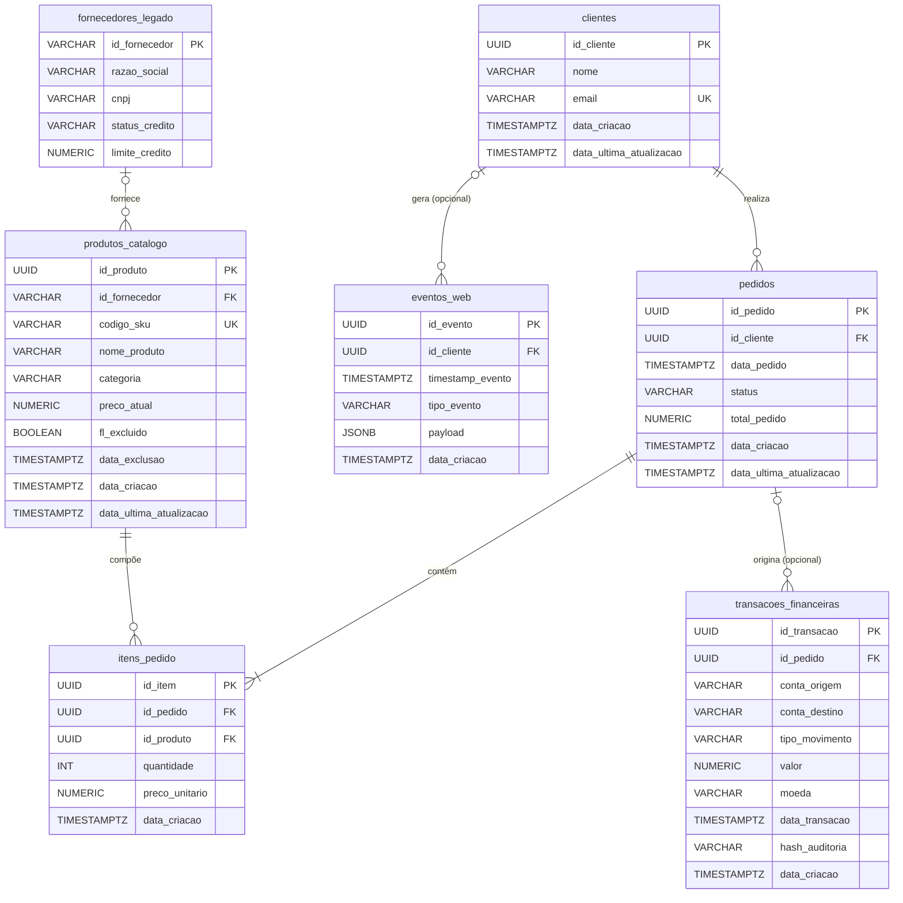
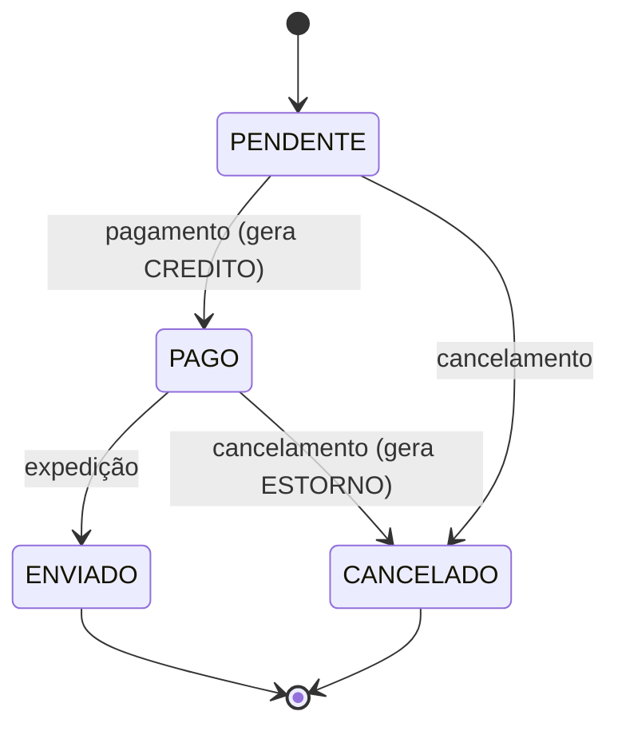

# Base de Dados de Origem: Esquema, Dicionário de Dados e Rotina de Geração

## 1. Objetivo

Este documento especifica a base de dados de origem do laboratório: o banco `lab_source`, no PostgreSQL. Ele cobre:

- o modelo de dados e o dicionário de cada tabela;
- as decisões de modelagem e a função didática de cada uma nos cenários de ingestão;
- a rotina de geração de dados sintéticos (`src/populate.py`), que faz a carga inicial e a simulação contínua de alterações.

A base representa, de forma simplificada, o sistema transacional (OLTP) de um comércio eletrônico. Nela há clientes, fornecedores, catálogo de produtos, pedidos e seus itens, movimentações financeiras e telemetria de navegação.

## 2. Modelo de dados

### 2.1 Diagrama entidade-relacionamento



### 2.2 Convenções

| Aspecto | Convenção |
|---|---|
| Nomenclatura | Tabelas e colunas em português, minúsculas, com `_` separando as palavras (*snake_case*) |
| Chaves primárias | `UUID` versão 4, exceto em `fornecedores_legado`, que usa um código textual (sistema legado) |
| Datas e horas | `TIMESTAMPTZ` (com fuso). O PostgreSQL armazena em UTC e converte na exibição conforme o fuso da sessão |
| Valores monetários | `NUMERIC` com precisão fixa. Nunca `FLOAT`, porque ponto flutuante introduz erro de arredondamento |
| Codificação | UTF-8, com ordenação ICU `pt-BR` |
| Auditoria de linha | `data_criacao` em todas as tabelas, exceto `fornecedores_legado`. `data_ultima_atualizacao` nas tabelas mutáveis, mantida por gatilho |

### 2.3 Arquivos de definição

O esquema está em `sql/02_schema.sql`. Ele é executado automaticamente na primeira inicialização do PostgreSQL e é **idempotente**:
- usa `CREATE ... IF NOT EXISTS` e `CREATE OR REPLACE`;
- pode ser reaplicado sem erro e sem perda de dados com `python src/populate.py schema`.

## 3. Dicionário de dados

Legenda: **PK** chave primária · **FK** chave estrangeira · **UK** restrição de unicidade · **NN** NOT NULL.

### 3.1 `clientes`

Cadastro de clientes da loja. Entidade central, referenciada pelos pedidos e, opcionalmente, pelos eventos de navegação.

| Coluna | Tipo | Restrições | Padrão | Descrição |
|---|---|---|---|---|
| `id_cliente` | UUID | PK | `uuid_generate_v4()` | Identificador do cliente |
| `nome` | VARCHAR(100) | NN | — | Nome completo |
| `email` | VARCHAR(100) | NN, UK | — | Endereço de e-mail, único por cliente |
| `data_criacao` | TIMESTAMPTZ | — | `CURRENT_TIMESTAMP` | Momento do cadastro |
| `data_ultima_atualizacao` | TIMESTAMPTZ | — | `CURRENT_TIMESTAMP` | Momento da última alteração; atualizado por gatilho |

### 3.2 `fornecedores_legado`

Fornecedores vindos de um sistema legado. A tabela foi modelada de propósito **sem colunas de auditoria temporal** (ver seção 4.1).

| Coluna | Tipo | Restrições | Padrão | Descrição |
|---|---|---|---|---|
| `id_fornecedor` | VARCHAR(50) | PK | — | Código do fornecedor no sistema legado (formato `FORN-XXXXXXXXXX`) |
| `razao_social` | VARCHAR(150) | NN | — | Razão social |
| `cnpj` | VARCHAR(14) | NN | — | CNPJ só com dígitos (14 caracteres, sem pontuação) |
| `status_credito` | VARCHAR(20) | — | — | Situação de crédito: `APROVADO`, `EM_ANALISE` ou `BLOQUEADO` (domínio não restringido no banco) |
| `limite_credito` | NUMERIC(12,2) | — | — | Limite de crédito concedido, em reais |

### 3.3 `produtos_catalogo`

Catálogo de produtos. Usa **exclusão lógica**: o produto não é apagado, apenas marcado como excluído.

| Coluna | Tipo | Restrições | Padrão | Descrição |
|---|---|---|---|---|
| `id_produto` | UUID | PK | `uuid_generate_v4()` | Identificador do produto |
| `id_fornecedor` | VARCHAR(50) | FK → `fornecedores_legado` | — | Fornecedor do produto (opcional) |
| `codigo_sku` | VARCHAR(50) | NN, UK | — | Código SKU (*Stock Keeping Unit*), formato `SKU-XXXXXXXXXX` |
| `nome_produto` | VARCHAR(100) | NN | — | Nome comercial |
| `categoria` | VARCHAR(50) | — | — | Categoria: Beleza, Casa, Eletrônicos, Esporte, Livros ou Moda |
| `preco_atual` | NUMERIC(10,2) | NN | — | Preço de venda vigente, em reais |
| `fl_excluido` | BOOLEAN | NN | `FALSE` | Indicador de exclusão lógica |
| `data_exclusao` | TIMESTAMPTZ | — | — | Momento da exclusão lógica; nulo se o produto está ativo |
| `data_criacao` | TIMESTAMPTZ | — | `CURRENT_TIMESTAMP` | Momento do cadastro |
| `data_ultima_atualizacao` | TIMESTAMPTZ | — | `CURRENT_TIMESTAMP` | Momento da última alteração; atualizado por gatilho |

### 3.4 `pedidos`

Cabeçalho dos pedidos de venda. O valor total é a soma dos itens.

| Coluna | Tipo | Restrições | Padrão | Descrição |
|---|---|---|---|---|
| `id_pedido` | UUID | PK | `uuid_generate_v4()` | Identificador do pedido |
| `id_cliente` | UUID | NN, FK → `clientes` | — | Cliente que fez o pedido |
| `data_pedido` | TIMESTAMPTZ | NN | — | Momento da compra |
| `status` | VARCHAR(20) | CHECK | — | Situação: `PENDENTE`, `PAGO`, `ENVIADO` ou `CANCELADO` |
| `total_pedido` | NUMERIC(10,2) | NN | — | Valor total: Σ(quantidade × preço unitário) dos itens |
| `data_criacao` | TIMESTAMPTZ | — | `CURRENT_TIMESTAMP` | Momento do registro |
| `data_ultima_atualizacao` | TIMESTAMPTZ | — | `CURRENT_TIMESTAMP` | Momento da última alteração (por exemplo, a mudança de status); atualizado por gatilho |

**Ciclo de vida do status:**



### 3.5 `itens_pedido`

Itens de cada pedido. Existem apenas enquanto o pedido existe (composição).

| Coluna | Tipo | Restrições | Padrão | Descrição |
|---|---|---|---|---|
| `id_item` | UUID | PK | `uuid_generate_v4()` | Identificador do item |
| `id_pedido` | UUID | NN, FK → `pedidos` (`ON DELETE CASCADE`) | — | Pedido ao qual o item pertence |
| `id_produto` | UUID | NN, FK → `produtos_catalogo` | — | Produto vendido |
| `quantidade` | INT | NN, CHECK (> 0) | — | Quantidade vendida |
| `preco_unitario` | NUMERIC(10,2) | NN | — | Preço praticado **no momento da venda** |
| `data_criacao` | TIMESTAMPTZ | — | `CURRENT_TIMESTAMP` | Momento do registro |

### 3.6 `transacoes_financeiras`

Livro de movimentações financeiras, só com inserções (*append-only*). Registra pagamentos e estornos de pedidos e também movimentos avulsos.

| Coluna | Tipo | Restrições | Padrão | Descrição |
|---|---|---|---|---|
| `id_transacao` | UUID | PK | `uuid_generate_v4()` | Identificador da transação |
| `id_pedido` | UUID | FK → `pedidos` | — | Pedido de origem; nulo em movimentos avulsos |
| `conta_origem` | VARCHAR(50) | NN | — | Conta debitada (formato `AGnnnn-CCnnnnnnnn`) |
| `conta_destino` | VARCHAR(50) | NN | — | Conta creditada |
| `tipo_movimento` | VARCHAR(10) | CHECK | — | `CREDITO` (entrada na loja), `DEBITO` (saída da loja) ou `ESTORNO` (devolução ao cliente) |
| `valor` | NUMERIC(15,4) | NN, CHECK (> 0) | — | Valor movimentado, com 4 casas decimais |
| `moeda` | VARCHAR(3) | — | `'BRL'` | Código da moeda (ISO 4217) |
| `data_transacao` | TIMESTAMPTZ | NN | — | Momento da movimentação |
| `hash_auditoria` | VARCHAR(256) | NN | — | SHA-256 (64 caracteres hexadecimais) dos campos da transação, para verificar a integridade |
| `data_criacao` | TIMESTAMPTZ | — | `CURRENT_TIMESTAMP` | Momento do registro |

A conta da loja é `AG0001-CC00000001`. Em `CREDITO`, ela é a conta de destino. Em `DEBITO` e `ESTORNO`, é a conta de origem.

### 3.7 `eventos_web`

Telemetria de navegação: eventos semiestruturados gerados no site, como visualizações, buscas e adições ao carrinho.

| Coluna | Tipo | Restrições | Padrão | Descrição |
|---|---|---|---|---|
| `id_evento` | UUID | PK | `uuid_generate_v4()` | Identificador do evento |
| `id_cliente` | UUID | FK → `clientes` | — | Cliente autenticado; nulo em navegação anônima |
| `timestamp_evento` | TIMESTAMPTZ | NN | — | Momento em que o evento ocorreu no site |
| `tipo_evento` | VARCHAR(50) | NN | — | `page_view`, `search`, `add_to_cart`, `checkout`, `login` ou `logout` |
| `payload` | JSONB | NN | — | Atributos do evento (estrutura variável; ver a seguir) |
| `data_criacao` | TIMESTAMPTZ | — | `CURRENT_TIMESTAMP` | Momento em que o evento foi gravado no banco |

**Estrutura do `payload`:**

| Chave | Presença | Descrição |
|---|---|---|
| `session_id` | sempre | Identificador (UUID) da sessão de navegação |
| `device` | sempre | `desktop`, `mobile` ou `tablet` |
| `browser` | sempre | `chrome`, `firefox`, `safari` ou `edge` |
| `url` | sempre | Caminho acessado (ex.: `/produto/SKU-...`, `/busca`, `/checkout`) |
| `sku` | `page_view` e `add_to_cart` | SKU do produto visualizado ou adicionado |
| `termo_busca` | `search` | Termo pesquisado |

A diferença entre `timestamp_evento` (quando o evento ocorreu) e `data_criacao` (quando foi gravado) é de 0 a 5 segundos. Ela representa a distinção entre **tempo do evento** (*event time*) e **tempo de ingestão** (*ingestion time*).

## 4. Proposições de modelagem e uso didático

Cada característica da base foi pensada para expor um problema real de ingestão. A tabela abaixo resume essas proposições; as seções seguintes detalham cada uma.

| Característica | Tabela(s) | Problema de ingestão exposto | Cenários |
|---|---|---|---|
| Ausência de coluna de atualização | `fornecedores_legado` | Impossibilidade de extração incremental: só carga completa ou CDC | 1, 2, 3 |
| Coluna de atualização mantida por gatilho | `clientes`, `produtos_catalogo`, `pedidos` | Extração incremental por marca d'água (*watermark*) | 1 |
| Exclusão lógica | `produtos_catalogo` | Uma exclusão chega como UPDATE e precisa ser interpretada | 1, 2, 3, 4 |
| Exclusão física | `pedidos` (com cascata em `itens_pedido`), `eventos_web` | DELETE é invisível à extração por consulta; só o CDC captura | 2, 3 |
| Tabela só com inserções | `transacoes_financeiras`, `eventos_web` | Ingestão incremental por inserção | 1, 3 |
| Dados semiestruturados | `eventos_web.payload` (JSONB) | Achatamento de JSON e evolução de esquema | 1, 4 |
| Preço histórico no item | `itens_pedido.preco_unitario` | Fato com valor congelado no momento da venda × dimensão mutável (`preco_atual`) | 4 |
| Valores decimais exatos | colunas monetárias | Preservação de precisão na conversão para Parquet e Iceberg | 1, 4 |
| `REPLICA IDENTITY FULL` | todas | Imagem anterior completa (*before image*) nos eventos de UPDATE e DELETE | 2, 3 |

### 4.1 Tabela legada sem marca temporal

`fornecedores_legado` não tem `data_criacao` nem `data_ultima_atualizacao`. Isso representa uma situação comum em sistemas antigos. Como não há como identificar quais linhas mudaram desde a última extração, sobram duas estratégias:
- **carga completa** (*full load*), com substituição integral do destino a cada execução;
- **CDC**, que obtém as alterações diretamente do log de transações.

A comparação entre as duas é um objetivo didático dos cenários 1 a 3.

### 4.2 Extração incremental e o gatilho de atualização

Nas tabelas `clientes`, `produtos_catalogo` e `pedidos`, a função `fn_set_data_ultima_atualizacao()` atribui `CURRENT_TIMESTAMP` à coluna `data_ultima_atualizacao` em todo UPDATE. Ela é executada pelos gatilhos `trg_<tabela>_atualizacao` (BEFORE UPDATE, FOR EACH ROW).

Sem o gatilho, a coluna só receberia o valor padrão no INSERT, e a extração incremental (`WHERE data_ultima_atualizacao > :ultima_marca`) não enxergaria as alterações.

**Limitação a explorar em aula:** `CURRENT_TIMESTAMP` é o instante de **início** da transação, não o do *commit*. Uma transação longa pode confirmar linhas com marca temporal anterior à última marca d'água já processada, e essas linhas seriam perdidas. Isso motiva a margem de segurança (*lookback*) na extração incremental e também a adoção de CDC.

### 4.3 Exclusão lógica × exclusão física

- **Lógica** (`produtos_catalogo`): o registro permanece, com `fl_excluido = TRUE` e `data_exclusao` preenchida. Para a ingestão, é um UPDATE comum, e quem consome os dados precisa aplicar a regra de negócio.
- **Física** (`pedidos` cancelados e sem transação financeira, junto com seus itens por `ON DELETE CASCADE`; e `eventos_web` mais antigos): o registro deixa de existir. Uma extração por consulta SQL não tem como detectar esse tipo de remoção. Só o CDC, que lê o WAL, registra o evento de DELETE.

### 4.4 Integridade referencial e restrições

- `itens_pedido → pedidos` usa `ON DELETE CASCADE`: excluir um pedido exclui seus itens. No CDC, isso produz eventos de DELETE também para os itens.
- `transacoes_financeiras → pedidos` **não** usa cascata. Um pedido com movimentação financeira não pode ser excluído, o que preserva o histórico contábil.
- `produtos_catalogo → fornecedores_legado` e `eventos_web → clientes` são opcionais (aceitam nulo).
- As restrições `CHECK` limitam os domínios de `status`, `tipo_movimento`, `quantidade` e `valor`. Já `status_credito` não tem restrição no banco, o que é intencional para um sistema legado: a validação do domínio fica a cargo do pipeline.

### 4.5 Identidade de réplica completa

Por padrão, o PostgreSQL registra no WAL, para UPDATE e DELETE, apenas a chave primária da linha anterior. Com `REPLICA IDENTITY FULL`, a linha anterior é registrada **completa**. Assim, os eventos de CDC trazem o estado anterior (`before`) e o posterior (`after`) de todas as colunas.

O custo é um volume maior de WAL. O benefício é poder auditar e reconstruir cada alteração.

### 4.6 Objetos auxiliares

| Objeto | Tipo | Definição | Finalidade |
|---|---|---|---|
| `uuid-ossp` | Extensão | `sql/02_schema.sql` | Fornece `uuid_generate_v4()` |
| `fn_set_data_ultima_atualizacao()` | Função PL/pgSQL | `sql/02_schema.sql` | Atualiza a coluna de auditoria |
| `trg_clientes_atualizacao`, `trg_produtos_catalogo_atualizacao`, `trg_pedidos_atualizacao` | Gatilhos | `sql/02_schema.sql` | Acionam a função em todo UPDATE |
| `lab_cdc_pub` | Publicação lógica | `sql/01_cdc_setup.sh` | Expõe todas as tabelas ao decodificador `pgoutput` |
| `cdc_reader` | Papel | `sql/01_cdc_setup.sh` | Usuário de replicação e leitura, sem superusuário |

## 5. Rotina de geração e população de dados (`src/populate.py`)

### 5.1 Visão geral

O script `src/populate.py` gera dados **sintéticos** coerentes com as regras de negócio e os grava na base de origem. É um único arquivo, em estilo procedural (apenas funções), organizado nas seções:

1. **Configuração:** leitura e validação do `.env` (`load_env`, `require`, `postgres_admin_config`);
2. **Geração de dados:** funções puras que recebem o gerador aleatório (`rng`) e o Faker e devolvem tuplas que correspondem a linhas das tabelas (`gerar_cliente`, `gerar_produto`, `gerar_transacao` etc.);
3. **Acesso ao banco:** verificação do esquema e carga via `COPY`;
4. **Subcomandos:** `schema`, `seed` e `simulate`;
5. **Interface de linha de comando:** `argparse` e tratamento de erros.

**Execução** (no contêiner do laboratório):

```powershell
docker compose exec python python src/populate.py <subcomando> [opções]
```

### 5.2 Subcomandos

| Subcomando | Função | Idempotência |
|---|---|---|
| `schema` | Aplica `sql/02_schema.sql` | Idempotente: pode ser reaplicado sem efeito colateral |
| `seed` | Carga inicial em volume | Protegida: recusa a execução se alguma tabela já tiver dados, salvo com `--append` |
| `simulate` | Gera INSERT, UPDATE e DELETE contínuos | Não idempotente por natureza: cada execução produz novas alterações |

**Parâmetros de `seed`:**

| Parâmetro | Padrão | Descrição |
|---|---|---|
| `--fornecedores` | 50 | Quantidade de fornecedores |
| `--produtos` | 500 | Quantidade de produtos |
| `--clientes` | 2000 | Quantidade de clientes |
| `--pedidos` | 10000 | Quantidade de pedidos; cada um tem de 1 a 5 itens |
| `--eventos` | 50000 | Quantidade de eventos de navegação |
| `--seed` | aleatória | Semente do gerador. A mesma semente produz os mesmos dados (ver 5.4) |
| `--append` | desligado | Permite inserir em tabelas que já têm dados |

**Parâmetros de `simulate`:**

| Parâmetro | Padrão | Descrição |
|---|---|---|
| `--interval` | 1.0 | Intervalo, em segundos, entre ciclos (*ticks*) |
| `--ops-per-tick` | 5 | Operações por ciclo |
| `--max-ticks` | infinito | Quantidade de ciclos; sem o parâmetro, executa até Ctrl+C |
| `--seed` | aleatória | Semente do gerador |

**Códigos de saída:**

| Código | Significado |
|---|---|
| 0 | Sucesso |
| 1 | Erro de banco de dados ou de estado (por exemplo, esquema ausente ou base já populada) |
| 2 | Configuração ou argumento inválido (por exemplo, `.env` ausente ou porta não numérica) |
| 3 | PostgreSQL inacessível |

### 5.3 Carga inicial (`seed`)

**Procedimento:**

1. verifica se as 7 tabelas existem e se estão vazias (a menos que `--append` tenha sido informado);
2. gera todas as linhas em memória, respeitando as dependências: fornecedores → produtos → clientes → pedidos, itens e transações → eventos;
3. grava cada tabela com o comando `COPY ... FROM STDIN (FORMAT csv)`, ordens de grandeza mais rápido que INSERTs individuais;
4. executa tudo em **uma única transação**: se ocorrer qualquer erro, nada é gravado (atomicidade).

**Regras de geração:**

| Entidade | Regra |
|---|---|
| Janela temporal | Pedidos, transações e eventos se distribuem de modo uniforme nos últimos **180 dias** |
| Clientes | Cadastrados entre 365 e 30 dias atrás; 20% têm alteração cadastral posterior |
| Produtos | Cadastrados entre 365 e 180 dias atrás; 5% com exclusão lógica |
| Preço | Distribuição **log-normal** por categoria (σ = 0,6), limitada a R$ 4,90 a R$ 4.999,90, com centavos fixos em ,90. Assim, a maioria dos produtos tem preço próximo da mediana da categoria e poucos são muito mais caros |
| Mediana de preço por categoria | Livros R$ 45 · Beleza R$ 55 · Moda R$ 80 · Casa R$ 90 · Esporte R$ 120 · Eletrônicos R$ 220 |
| Pedido × cliente | Primeiro sorteia-se a data do pedido; depois, um cliente **já cadastrado** naquela data |
| Status do pedido | ENVIADO 60% · PAGO 20% · PENDENTE 10% · CANCELADO 10% |
| Itens | 1 a 5 produtos ativos distintos por pedido, quantidade de 1 a 3, `preco_unitario` igual ao preço do produto |
| Mudança de status | Entre 0 e 10 dias depois do pedido (`data_ultima_atualizacao`); em pedidos PENDENTE, igual à data do pedido |
| Transações | CREDITO para todo pedido PAGO ou ENVIADO. Metade dos CANCELADO foi paga e estornada (CREDITO + ESTORNO); a outra metade nunca foi paga. Mais 10% do número de pedidos em movimentos avulsos (CREDITO ou DEBITO, sem pedido) |
| Eventos | 70% de clientes autenticados (sempre já cadastrados na data do evento) e 30% anônimos. Tipos: page_view 50%, search 15%, add_to_cart 15%, checkout 8%, login 7%, logout 5% |

### 5.4 Reprodutibilidade

Toda a aleatoriedade, inclusive os UUIDs, vem de um único gerador (`random.Random`) e de uma instância do Faker, ambos inicializados com a semente informada em `--seed`. Com a mesma semente, a mesma quantidade de registros e as mesmas versões das bibliotecas, a carga produz **o mesmo conteúdo**. Isso vale para o `seed`. O `simulate` também é determinístico na escolha das operações, mas as linhas que ele altera dependem do estado do banco e da função `random()` do PostgreSQL, que não usa a semente.

As datas são relativas ao momento da execução, ou seja, a janela termina "agora". Por isso o conteúdo é o mesmo, mas as datas absolutas se deslocam conforme o dia em que o script roda.

### 5.5 Simulação contínua (`simulate`)

Gera tráfego transacional realista para os cenários de CDC. A cada ciclo, o script sorteia `--ops-per-tick` operações, segundo os pesos abaixo, e as executa numa **única transação**. Se ocorrer erro ou houver interrupção (Ctrl+C), o ciclo é desfeito por completo. Por isso nunca há gravação parcial.

| Operação | Peso | Comando SQL | Efeito |
|---|---|---|---|
| `insert_pedido` | 20% | INSERT | Novo pedido PENDENTE com itens |
| `insert_evento` | 20% | INSERT | Novo evento de navegação |
| `pagar_pedido` | 15% | UPDATE + INSERT | PENDENTE → PAGO, com transação de CREDITO |
| `enviar_pedido` | 12% | UPDATE | PAGO → ENVIADO |
| `insert_cliente` | 10% | INSERT | Novo cliente |
| `update_preco_produto` | 6% | UPDATE | Reajuste de −15% a +15% no preço de um produto ativo |
| `cancelar_pedido` | 5% | UPDATE (+ INSERT) | PENDENTE ou PAGO → CANCELADO; se estava pago, gera ESTORNO |
| `update_cliente` | 4% | UPDATE | Alteração do nome ou do e-mail |
| `update_fornecedor` | 3% | UPDATE | Alteração do status e do limite de crédito (tabela sem coluna de atualização) |
| `delete_pedido_cancelado` | 2% | DELETE (+ cascata) | Exclusão física de pedido cancelado sem transação, junto com seus itens |
| `delete_evento_antigo` | 2% | DELETE | Exclusão física do evento mais antigo |
| `soft_delete_produto` | 1% | UPDATE | Exclusão lógica de um produto |

Uma operação sem linha candidata (por exemplo, `enviar_pedido` sem nenhum pedido PAGO) é registrada como "ignorada" e não gera erro. O registro (log) de cada ciclo e o resumo final mostram a contagem de operações aplicadas e ignoradas.

**Relógio de referência:** as datas gravadas pelo `simulate` (`data_pedido`, `data_transacao` e `timestamp_evento`) usam o horário da transação no banco (`CURRENT_TIMESTAMP`), e não o relógio do Python. Assim, essas datas são coerentes com as colunas que o próprio banco preenche (valores padrão e gatilho de `data_ultima_atualizacao`). Com dois relógios diferentes, uma atualização poderia ficar registrada alguns milissegundos antes do pedido a que se refere.

### 5.6 Invariantes garantidas

As regras abaixo valem depois do `seed` e continuam valendo depois de qualquer número de ciclos do `simulate`. Os alunos podem usá-las como testes de qualidade de dados, na origem e no destino:

| Invariante | Consulta de verificação (resultado esperado: 0) |
|---|---|
| Total do pedido igual à soma dos itens | `SELECT count(*) FROM pedidos p WHERE total_pedido <> (SELECT sum(quantidade * preco_unitario) FROM itens_pedido i WHERE i.id_pedido = p.id_pedido);` |
| Todo pedido tem ao menos um item | `SELECT count(*) FROM pedidos p WHERE NOT EXISTS (SELECT 1 FROM itens_pedido i WHERE i.id_pedido = p.id_pedido);` |
| Pedido PAGO ou ENVIADO tem CREDITO | `SELECT count(*) FROM pedidos p WHERE status IN ('PAGO','ENVIADO') AND NOT EXISTS (SELECT 1 FROM transacoes_financeiras t WHERE t.id_pedido = p.id_pedido AND tipo_movimento = 'CREDITO');` |
| Pedido não é anterior ao cadastro do cliente | `SELECT count(*) FROM pedidos p JOIN clientes c USING (id_cliente) WHERE p.data_pedido < c.data_criacao;` |
| Atualização não é anterior ao pedido | `SELECT count(*) FROM pedidos WHERE data_ultima_atualizacao < data_pedido;` |
| Exclusão lógica coerente | `SELECT count(*) FROM produtos_catalogo WHERE fl_excluido <> (data_exclusao IS NOT NULL);` |
| CNPJ com 14 dígitos | `SELECT count(*) FROM fornecedores_legado WHERE cnpj !~ '^\d{14}$';` |
| Hash de auditoria válido | `SELECT count(*) FROM transacoes_financeiras WHERE hash_auditoria !~ '^[0-9a-f]{64}$';` |

As duas invariantes a seguir valem apenas para os dados da carga inicial (`seed`):
- itens de pedido não referenciam produtos excluídos logicamente;
- toda transação de pedido está entre `data_pedido` e `data_ultima_atualizacao` do pedido.

No `simulate`, um produto pode ser excluído depois de vendido, e as transações recebem o horário do momento da execução.

### 5.7 Valores de referência

Carga obtida com `python src/populate.py seed --seed 42` e volumes padrão:

| Tabela | Linhas |
|---|---|
| `fornecedores_legado` | 50 |
| `produtos_catalogo` | 500 (22 com exclusão lógica) |
| `clientes` | 2.000 (440 com acentuação no nome) |
| `pedidos` | 10.000 |
| `itens_pedido` | 29.925 (média de 2,99 por pedido) |
| `transacoes_financeiras` | 9.986 (CREDITO 8.987 · DEBITO 506 · ESTORNO 493; 1.000 avulsas) |
| `eventos_web` | 50.000 (30% anônimos) |

| Métrica | Valor |
|---|---|
| Status dos pedidos | ENVIADO 6.015 · PAGO 1.985 · PENDENTE 1.013 · CANCELADO 987 |
| Pedidos cancelados | 493 estornados · 494 sem transação |
| Preço dos produtos | mínimo R$ 11,90 · mediana R$ 92,40 · média R$ 122,50 · máximo R$ 1.060,90 |
| Valor dos pedidos | mediana R$ 601,55 · média R$ 733,96 · máximo R$ 6.269,00 |
| Pedidos por dia | mínimo 33 · média 55,6 · máximo 83 |
| Tamanho do banco | ≈ 30 MB |
| Duração da carga | ≈ 5 segundos |

### 5.8 Privacidade dos dados

Todos os dados são **fictícios**:
- nomes e razões sociais são gerados pelo Faker (localidade `pt_BR`);
- os e-mails usam o domínio reservado `example.com` (RFC 2606) e têm um sufixo aleatório que garante unicidade;
- CNPJs, contas bancárias e SKUs são sintéticos;
- o `payload` dos eventos não contém endereço IP nem e-mail.

Os registros (logs) do script mostram apenas contagens por tabela e por operação. Nunca exibem o conteúdo das linhas nem credenciais. As mensagens de erro do PostgreSQL são reduzidas ao texto principal, sem o campo `DETAIL`, que pode conter valores de colunas.

### 5.9 Limitações conhecidas

- A seleção aleatória de linhas no `simulate` usa `ORDER BY random()`, que percorre a tabela inteira. É adequado ao volume do laboratório, mas não escala para tabelas grandes.
- No `simulate`, as datas de novos registros e de mudanças de status correspondem ao instante da execução. A regra de 0 a 10 dias entre o pedido e a mudança de status vale apenas para a carga inicial.
- Há poucas razões sociais com acentuação, porque o Faker as compõe a partir de sobrenomes.
- `status_credito` não tem restrição de domínio no banco (seção 4.4).

## 6. Referência rápida

```powershell
# Reaplicar o esquema (idempotente)
docker compose exec python python src/populate.py schema

# Carga inicial reproduzível
docker compose exec python python src/populate.py seed --seed 42

# Carga adicional sobre dados existentes
docker compose exec python python src/populate.py seed --append --pedidos 1000 --eventos 5000

# Simulação contínua (Ctrl+C para encerrar)
docker compose exec python python src/populate.py simulate --interval 1 --ops-per-tick 5

# Simulação com quantidade fixa de ciclos
docker compose exec python python src/populate.py simulate --max-ticks 100 --interval 0.5

# Recomeçar do zero (APAGA TODOS OS DADOS do laboratório)
docker compose down -v
docker compose up -d --wait
docker compose exec python python src/populate.py seed --seed 42
```
